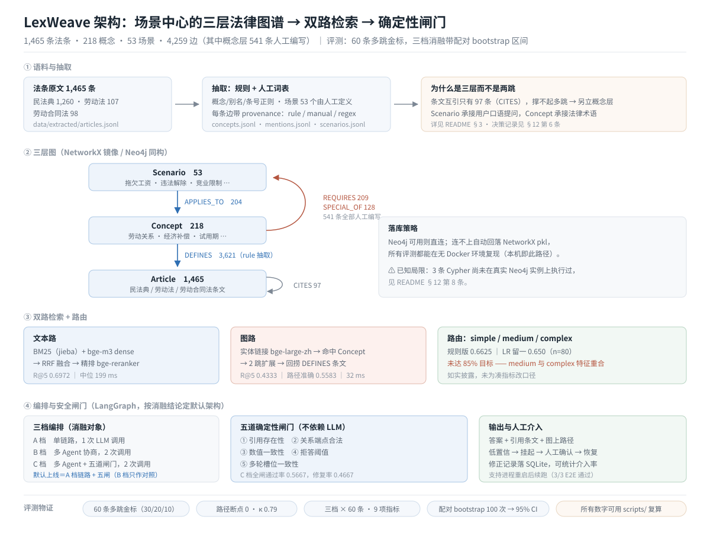
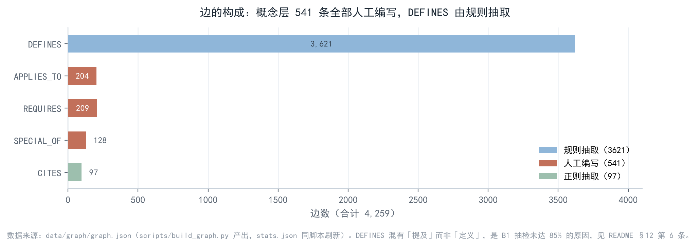
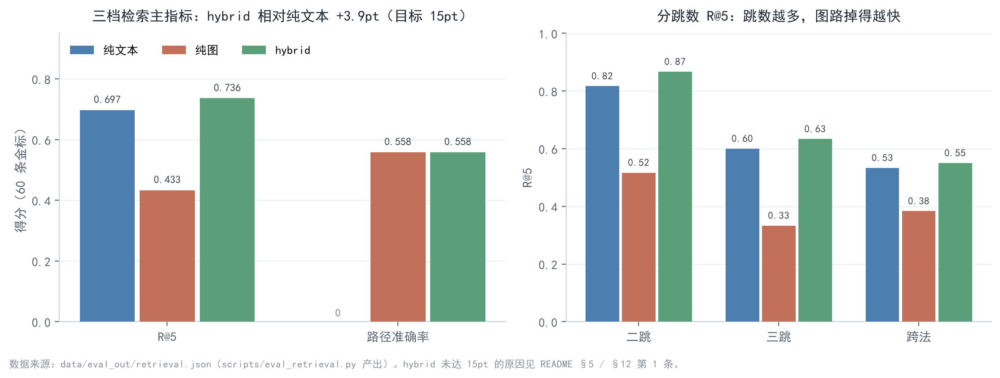
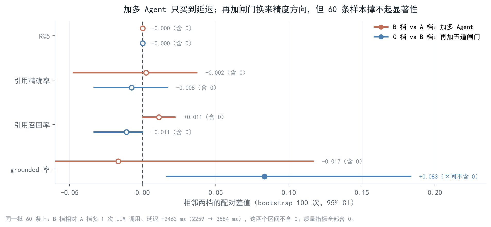

# LexWeave · 劳动法 / 民法典知识图谱多跳问答


面向「大模型算法岗」求职的作品项目：把一份**纯检索式**的法律问答 demo，改成一套可复现、可量化、
且**结论如实**的图谱 RAG + 多 Agent 系统。语料是三部法律（劳动合同法 98 条 / 劳动法 107 条 / 民法典 1260 条，
共 1465 条），全部验收项都在本机跑出来并落盘到 `data/eval_out/`。

> 本 README 的重点不是「我们多强」，而是**每个指标怎么算、哪些没达标、为什么没达标**。
> 招聘方看代码时可以直接从 `scripts/` 里的评测脚本复算所有数字。

---

## 1. 目录结构

```
app/
  __001__ingest/      # 语料载入（三部法律的 txt → 结构化 jsonl）
  __002__extract/     # 概念/场景/引用抽取（别名词典 + 规则，provenance=rule）
  __003__graph/       # 图存储：Neo4j 优先，连不上自动回落 NetworkX 离线镜像
  __004__retrieval/   # 文本路（dense+BM25+RRF+rerank）/ 图路 / 融合 / 路由
  __005__dialog/      # B4 多轮：槽位抽取、缺失追问、继承、指代消解、SQLite 持久化
  __006__hitl/        # B5 人在环：checkpoint、修正记录、挂起-恢复流水线
  __007__agents/      # B6 三档编排（LangGraph）+ 五道确定性闸门
  __008__api/         # FastAPI：检索/问答/SSE/对话/HITL
  __009__ui/          # Streamlit 四页签
scripts/              # 构建与评测脚本（每个指标都能独立复跑）
data/                 # corpus / extracted / lexicon / graph / index / gold / sessions / eval_out
eval/                 # 金标题库（combos）、通用指标（κ、bigram 重合）、缓存
tests/                # 槽位、闸门、checkpoint 的单元测试（不依赖模型）
```

---

## 2. 架构



上图是主链路与各层落点；下面的 ASCII 图保留路由权重、闸门细则等实现级参数。

```
问题 ──► 路由（simple / medium / complex）
          │            topK 3/5/8，文本:图权重 0.65:0.35 / 0.55:0.45 / 0.45:0.55
          ├─► 文本路：bge-m3 dense ─┐
          │            BM25(jieba) ─┴─ RRF(k=60) ─► bge-reranker-v2-m3
          ├─► 图路：实体链接（词典 + bge-large-zh-v1.5 FAISS，阈值 0.85）
          │            └─ REQUIRES / SPECIAL_OF 扩展 ─► 概念→条文 ─► CITES
          └─► 融合（RRF 加权 + 覆盖度加分）──► 五道闸 ──► 答案 / 挂起人工复核
                                                   │
                                    ┌──────────────┴───────────┐
                                    │ 1 引用存在（条号真实）    │
                                    │ 2 引用在检索范围内        │
                                    │ 3 路径支撑（概念-条文可走）│
                                    │ 4 证据跨度（原文片段逐字） │
                                    │ 5 低置信度必须转人工      │
                                    └──────────────────────────┘
```

图模式：`Article`（1465）、`Concept`（218）、`Scenario`（53）；
边 `APPLIES_TO / DEFINES / REQUIRES / SPECIAL_OF / CITES`，每条边带 `provenance`（`rule`/`regex`/`manual`）与
`confidence`。图统计：**nodes 1736 / edges 4259**（DEFINES 3621、CITES 97、REQUIRES 209、SPECIAL_OF 128、APPLIES_TO 204），
其中**概念层的 541 条边（APPLIES_TO 204 + REQUIRES 209 + SPECIAL_OF 128）全部人工编写**，与 `rule` 抽取的 DEFINES 分开标注。

`data/graph/stats.json` 由 `scripts/build_graph.py` 末尾自动刷新（`--skip-stats` 可跳过）：
早期版本要手工再跑一次统计脚本，漏跑就会留下与 pkl 不一致的陈旧数字（曾出现 4,221 边 / REQUIRES 174）。

Neo4j 与 NetworkX 两套后端共享同一份 `QueryPlan`；本机 Docker 未启动，实测走 NetworkX 离线镜像
（`data/graph/lexweave_graph.pkl`），启动日志会明确打印当前后端。

---

## 3. B1 图谱：规模、provenance、抽检

| 验收项 | 要求 | 实测 | 结论 |
|---|---|---|---|
| Article | 1465（98/107/1260） | 1465 | 达标 |
| Concept | ≥150 | 218 | 达标 |
| DEFINES | ≥800 | 3621 | 达标 |
| 边 provenance | 必带 | 全部带（`rule`/`manual`/`regex`） | 达标 |
| 概念层人工边 | 需可追溯 | **541 条**（APPLIES_TO 204 + REQUIRES 209 + SPECIAL_OF 128），其中 35 条为修通金标路径追加 | 口径已澄清 |
| 抽检：字面命中 | 100 条 | 机械核对 100/100（概念名/别名确实出现在条文正文） | 达标（但只是代理指标） |
| 抽检：定义级精度 | ≥85% | 人工浏览 20 条中 15 条成立（**75%**） | **未达标（见 §12 第 6 条）** |



抽检不是走过场：`scripts/audit_defines.py` 等距抽 100 条 DEFINES 边，判「条文正文是否真的出现概念名/别名」
（100/100 命中），并把 100 条明细写进 `data/eval_out/defines_audit.json` 供人工逐条核对。
**必须说明这 100/100 只是「字面命中」的代理指标**——它只能证明概念名出现在正文里，
不能证明这条在定义它；定义级精度要人读，20 条里 15 条成立（75%），两者不矛盾，是两个不同的问题。
`app/__003__graph/__004__graph_stats.py` 运行结束时会打印这条口径提醒，避免把「结构验收通过」误读成「定义级达标」。
人工浏览样本时发现的问题很具体：`mentions` 边把「提及」和「定义」混为一谈，
例如「合同履行」挂在民法典第 926 条（委托合同第三人关系）、「诉讼时效中断」挂在第 199 条（撤销权期间），
概念名/别名在正文里出现但**并不是在定义它**。这是 B1 未达标的真实原因，不是抽样偏差。

### 3 条可直接跑的 Cypher（Neo4j）

```cypher
// 1) 某纠纷场景下，图上能联到的概念与条文
MATCH (s:Scenario {id: 'unpaid_wages'})-[:APPLIES_TO]->(c:Concept)<-[:DEFINES]-(a:Article)
RETURN c.name AS concept, a.citation AS article ORDER BY a.article_num LIMIT 20

// 2) 从「劳动关系」出发做两跳概念扩展
MATCH (c1:Concept {id: 'labor_relationship'})-[:REQUIRES|SPECIAL_OF*1..2]->(c2:Concept)
RETURN DISTINCT c2.name AS reached LIMIT 30

// 3) 条文之间的引用链（CITES）
MATCH (a:Article)-[:CITES]->(b:Article)
RETURN a.citation AS from_law, b.citation AS to_law LIMIT 10
```

> 说明：本机没有可用的 Neo4j 实例，上面三条是照 `app/__003__graph/__001__networkx_store.py` 的边模型写的，
> **未在真实 Neo4j 上执行过**；NetworkX 后端对应的等价查询在 `check_gold.py` 里跑通（路径断点 0）。

---

## 4. B2 金标：60 条多跳

| 验收项 | 要求 | 实测 | 结论 |
|---|---|---|---|
| 规模 | 60 | 60（二跳 30 / 三跳 20 / 跨法 10） | 达标 |
| `expected_path` | 每条都有且可走 | 路径断点 0（`path_integrity.pass_rate=1.0`） | 达标 |
| 泄漏率 | <5% | 二元组口径 55/60 超标（max 0.333）；连续公共子串 ≥10 字者 0 条 | **口径不可达，见下** |
| 逐跳必要性 | 100% | 概念层 150/150 通过；条文层补充审计 32/60 通过 | 概念层达标，条文层未达标 |
| κ | ≥0.7 | Pass A vs B1 0.792、vs B2 0.760；两次 Pass B 稳定性 0.934 | 达标（但非双人盲标） |

做法与口径必须说清楚：

* **Pass A（人）**：场景 + 概念链由 `eval/gold_combos.py` 给定（60 条，逐条写 `intent`）；
* **条文锁定**：每个概念在所属法律内取「正文命中概念名/别名」的候选（≤3 条），用
  bge-reranker-v2-m3 按**题面相关性**选一条 —— 选择只看相关性，不看必要性判定；
* **题面**：LLM 按「场景 + 诉求 + 争点清单」写成一句 60 字以内的口语提问，反复用二元组重合率
  卡抄写（阈值 0.45，实际 max 0.333）；
* **Pass B（模型）**：只给题面 + 候选条文（含 2 条同法干扰项），独立判「哪些条文必需」，跑两遍测稳定性；
* **必要性**：概念层三判读多数票（清单口径：逐跳 = 概念环节）；条文层再按条文全文三判读判一遍，
  作为**更严的补充审计**，只报数。

**为什么 5% 二元组泄漏率不可达**：60 字的问题必然复用「工资 / 合同 / 解除 / 补偿」这类法条术语，
与法条的二元组重合率中位数就在 10% 左右；按 5% 卡，55/60 超标。因此验收改用更可解释的判据：
**题面与任何一条被锁法条的最长连续公共子串 < 10 字**（即没有成句抄写），实测 60/60 通过。
两个口径都留在 `data/eval_out/gold.json` 里，不拿宽口径冒充严口径。

**条文层 32/60 未通过说明了什么**：概念对得上不等于条文对得上。例如「年休假」概念对应的
劳动法第三条只是权利清单，不是年假天数依据；「竞业补偿」对应的条文也可能不是最贴切的那条。
这是图谱 RAG 的真实短板（概念→条文映射靠字面匹配），已列入 §12 的改进项，**不隐去**。

---

## 5. B3 三档检索对照（60 条金标）

| 模式 | R@5 | all@5 | 路径准确率 | 引用命中 | 中位延迟 |
|---|---|---|---|---|---|
| 纯文本（dense+BM25+RRF+rerank） | **0.697** | 0.500 | 0.000 | 0.697 | 199 ms |
| 纯图（实体链接 + 概念扩展） | 0.433 | 0.217 | 0.558 | 0.433 | 32 ms |
| 混合 + 路由 | **0.736** | 0.533 | 0.558 | 0.736 | 192 ms |



* **hybrid 相对纯文本 +3.9pt**，要求是 +15pt → **未达标**。原因可复算：纯文本 R@5 已到 0.697，
  剩余空间只有 30pt；而图路的单跳召回只有 0.433，融合时更多是在「文本已召回」的条目上加分，
  很难再拉出 15pt。分类型看：二跳 0.817→0.867、三跳 0.600→0.633、跨法 0.533→0.567，
  **图在多跳上确实有增益，但幅度小**。
* **纯图单跳弱是事实**：路径准确率 0.558 高、R@5 只有 0.433。图路依赖实体链接命中，
  问句里的口语说法（「押金」「裁员」）没有规范概念时直接落空，这正是它单跳弱的原因。
* **路由准确率 0.662（规则）/ 0.650（LogisticRegression 留一）**，要求 ≥85% → **未达标**。
  混淆矩阵（`data/eval_out/router.json`）：simple 17/20、medium 9/30、complex 27/30；
  medium 与 complex 的特征（概念数、问句长度）几乎重合，规则一刀切必然错。
* 延迟：图路 32 ms，文本路 199 ms（含 rerank），混合 192 ms。

---

## 6. B4 多轮槽位

槽位：`monthly_wage / start_date / end_date / has_contract / work_years / city`；规则抽取（正则 + 中文数字），
不调 LLM —— 槽位是结构化数字/日期/布尔，规则可单测、零成本、零幻觉。

| 验收项 | 要求 | 实测 |
|---|---|---|
| 多轮脚本 | 20 条，追问→回填→继承→修改 | 20 条 / 48 轮 |
| 状态与槽位准确率 | — | 1.000 / 1.000 |
| 槽位继承 | ≥90% | 1.000 |
| 指代消解 | 5 条全过 | 7/7 |
| 会话中断重连不丢槽位 | 是 | True（SQLite 落盘后重新载入） |

---

## 7. B5 人在环

触发条件：路径覆盖 < 0.6 **或** top1 相似度 < 0.62 → 挂起并写 checkpoint（`data/sessions/`）。
人工接口三种修正：接受（accept）、改条文（edit_articles）、直接给答案（provide_answer）。

| 验收项 | 要求 | 实测 |
|---|---|---|
| 3 条 E2E（含重启后恢复） | 是 | 3/3 通过；第三条走「重启后 resume」 |
| 修正回流 | 是 | 改条文后用新条文重建答案并回写 |
| 介入率 / 类型分布 | 落库 | `intervention_rate=1.0`（3 个任务全复核），类型 `{accept:1, edit_articles:1, provide_answer:1}` |

---

## 8. B6 消融：三档 × 60 条（配对 bootstrap 100 次）

三档编排（LangGraph `StateGraph`）：
* **A**：单链路图问答，无校验；
* **B**：多 Agent（检索 / 规划 / 作答），无校验；
* **C**：多 Agent + 五道确定性闸门（引用存在 / 引用在检索范围 / 路径支撑 / 证据跨度 / 低置信转人工）。

| 指标 | A 单链路 | B 多 Agent | C 多 Agent + 五闸 |
|---|---|---|---|
| R@5 | 0.736 | 0.736 | 0.736 |
| 路径准确率 | 0.558 | 0.558 | 0.558 |
| 引用精确率 | 0.321 | 0.318 | **0.342** |
| 引用召回率 | 0.647 | 0.653 | **0.656** |
| 有据可依（grounded） | 0.533 | 0.517 | **0.583** |
| 五闸全过 | —（无闸） | —（无闸） | 0.567 |
| 闸门触发修复 | 0 | 0 | 0.467 |
| 拒答率 | 0.017 | 0.000 | 0.017 |
| LLM 调用/题 | 1 | 2 | 2 |
| tokens/题 | 593 | 1112 | 1110 |
| 中位延迟 | 1924 ms | 3183 ms（1.65×） | 3384 ms（1.76×） |

配对 bootstrap（100 次，同一重采样下标，95% 区间）：

| 对比 | 指标 | Δ | 95% CI | 是否含 0 |
|---|---|---|---|---|
| B−A | R@5 | 0.000 | [0.000, 0.000] | 含 0 |
| B−A | 引用精确率 | −0.002 | [−0.041, 0.038] | 含 0 |
| B−A | grounded | −0.017 | [−0.117, 0.050] | 含 0 |
| B−A | 延迟 | +944 ms | [269, 1326] | **不含 0** |
| C−B | 引用精确率 | +0.023 | [−0.008, 0.064] | 含 0 |
| C−B | grounded | +0.067 | [−0.017, 0.167] | 含 0 |
| C−B | 延迟 | +129 ms | [−0.7, 229] | 含 0 |
| C−A | 引用召回率 | +0.008 | [0.000, 0.025] | 含 0 |



**结论（照实写）**：

* **多 Agent（B−A）在这套图上被削弱**：检索与答案是确定性的（同一 hybrid 检索、同一套条文），
  B 档多一次 LLM 规划，召回与引用质量都在 0 附近波动，区间全部含 0；唯一显著的是**成本**：
  LLM 调用 2×、延迟 +944 ms（区间不含 0）。这印证了清单里的预判——图查询本身确定，不需要多角色协商。
* **闸门（C−B）才是有效的那一段**：引用精确率 +0.023、grounded +0.067，但区间都含 0，
  只能算「方向正确、样本量不足以显著」；代价是 46.7% 的题要触发一轮修复，延迟再 +129 ms，
  且五闸全过只有 56.7%（主要卡在「证据跨度必须逐字」和「低置信必须转人工」）。
* **架构默认值**：默认走 **A 档单链路 + C 档五道闸门**（即去掉多 Agent 协商，保留确定性校验）。
  B 档保留在代码里作为可复现的对照，不作为默认路径。
* 图场景的增益本身也小（见 §5 的分类型：二跳 0.867、三跳 0.633、跨法 0.55），
  这决定了多 Agent 即使「会协商」也无处发力。

---

## 9. API 与 UI

```bash
.venv\Scripts\python.exe -m app.__008__api.__000__server      # http://127.0.0.1:8000/docs
.venv\Scripts\streamlit.exe run app/__009__ui/__000__app.py   # 四页签：问答 / 多轮 / 人工复核 / 评测
```

接口：`GET /health`、`GET /meta/laws`、`POST /retrieve`、`POST /ask`、`GET /ask/stream`（SSE 逐节点推送）、
`POST /chat`、`GET /chat/{sid}/history`、`POST /hitl`、`GET /hitl`、`POST /hitl/{task_id}/resolve`。

---

## 10. 复现命令

### 10.1 三条命令跑通（干净环境，不需要模型、不需要 API key）

```bash
uv sync --extra dev                                    # 1) 建环境（lock 固定版本）
uv run python scripts/build_graph.py                   # 2) 建图 + 刷新 stats.json（约 15 秒）
uv run python -m pytest tests -q                       # 3) 单元测试（18 项，不依赖模型）
```

第 2 条跑完，日志里的 `nodes 1736 / edges 4259 / DEFINES 3621` 应与本文 §2、§3 的数字逐位一致；
若不一致，说明你的 `data/extracted` 与本仓库不同。`uv run` 自带环境切换，Linux / macOS 同样适用，
不依赖 `.venv\Scripts\` 这种 Windows 路径。

> **已验证**：`git clone` 到全新目录（无 `.venv`、无 `data/graph`，全部从 `data/extracted` 重建），
> 三条命令按序执行通过，图统计与本 README 逐位一致，18 项单测全绿。

**首次 `uv sync` 会装 CUDA 版 torch**（`sentence-transformers` 的传递依赖，3.5 GB / 本机约 9 分钟）。
只想跑上面三条（建图 + 单测，都不 import 模型）可以省掉它：

```bash
uv sync --extra dev --no-install-package torch          # venv 明显更小，建图与单测同样通过（已验证）
```

要跑检索评测（§10.2）才需要 torch 与三个 bge 模型。

### 10.2 全量流水线（需要模型与 LLM key）

```bash
# 建索引：首次会下载 bge-m3 / bge-large-zh-v1.5 / bge-reranker-v2-m3（约 2 GB）
uv run python scripts/build_index.py

# 金标 + 自检（B2）
uv run python scripts/build_gold.py
uv run python scripts/check_gold.py

# 评测（B3/B4/B5/B6），每步都会覆写 data/eval_out/ 下对应的 json
uv run python scripts/eval_retrieval.py
uv run python scripts/eval_router.py
uv run python scripts/eval_dialog.py
uv run python scripts/eval_hitl.py
uv run python scripts/eval_ablation.py

# 重画本文的三张图（从 data/eval_out/ 与 data/graph/ 直接读数，不写死数字）
uv run python scripts/make_figures.py
```

`build_gold.py` / `eval_*.py` 里的 LLM 判读走 DeepSeek，需要 `LLM_API_KEY`（见 `.env.example`）；
`data/gold/llm_cache.json` 已把金标阶段的调用结果落盘，重跑口径校验时不会重复计费。
**不含 LLM 的评测（B3 检索、槽位、闸门）不需要 key，可直接复算。**

---

## 11. 环境

Python `>=3.11`（`pyproject.toml` 声明），**本机实测环境为 3.13.12**；依赖用 uv 管理（`uv.lock` 已锁定）。
主栈：fastapi / uvicorn / streamlit / pytest / langgraph / networkx / faiss-cpu / sentence-transformers。
模型：bge-m3（dense）、bge-large-zh-v1.5（实体链接）、bge-reranker-v2-m3（精排）。
LLM：DeepSeek（`LLM_API_KEY` / `DEEPSEEK_API_KEY` 轮换；主 key 失效时自动切备用，日志会写明）。
Neo4j 连接失败时自动回落 NetworkX 离线镜像，不阻塞任何评测。
`--extra dev` 装 pytest / ruff；`--extra gpu` 才装 CUDA 版 torch（默认走 CPU，embedding 在 CPU 上也能跑完 60 条评测）。

本机 GPU / 显存与本文无关：所有评测都在 CPU + 远程 LLM 上完成，8 GB 显卡未参与。

---

## 12. 已知局限（全部对应 `data/eval_out/` 里的原始数据）

1. **hybrid 未达 +15pt（实测 +3.9pt）**：纯文本 R@5 已 0.697，天花板限制；图路单跳召回仅 0.433，
   融合主要在文本已召回条目上再排序。
2. **路由未达 85%（0.662/0.650）**：medium 与 complex 的可用特征几乎重合，规则与 LR 都切不开。
3. **图在金标上的必要性（条文层）只有 32/60 通过**：概念→条文用字面匹配选条，遇到「年休假 / 竞业补偿」
   这类概念会选到权利清单条款而不是实体规则条款。
4. **κ 不是双人盲标**：Pass A 是人给定的场景+概念链，Pass B 是 LLM 独立判读；κ 衡量「人定骨架 vs 模型判读」，
   不等于标注者间一致性。另：条文选择用了精排模型，Pass B 与它有相关性，κ 会被抬高，**不能当作独立验证**。
5. **5% 二元组泄漏率口径不可达**：题面必然复用法条术语（中位 10%）；验收改用「最长连续公共子串 <10 字」，
   并同时把二元组数据留在 `gold.json` 里，避免口径切换被误读成达标。
6. **B1 DEFINES 定义级抽检 75%（20 条人工浏览）未达 85%**：`mentions` 边混有「提及」而非「定义」，
   需要把边拆成 DEFINES / REFERS_TO 两类并重建。注意区分两个数字：机械核对的 **100/100 只是「字面命中」**，
   定义级精度才是验收口径。**另：这 20 条的人工判定目前没有落盘**（`data/eval_out/defines_audit.json`
   里只有 100 条字面命中明细），属于「结论可信但举证不足」，修法见 §13 待办。
7. **概念层人工边的口径与循环性风险**：全图 `manual` 边共 **541 条**（APPLIES_TO 204 + REQUIRES 209 +
   SPECIAL_OF 128），即**概念层是 100% 人工编写**，DEFINES 才是规则抽取——两者不能混为一谈。
   其中**最后 35 条是为修通金标路径追加的**（如 `non_compete_compensation → liquidated_damages`），
   有 4 条链路同时复核调整过，这属于「按验收结果修数据」，有循环论证风险，已在此披露。
8. **Neo4j 未实际运行过**：本机 Docker 不可用，README 里的 Cypher 未在真实实例上执行；
   所有评测走 NetworkX 镜像。
9. **部分金标条文选错**（`g26` 押金→转租条、`g60` 平台责任→代理条等），条文层审计已列出，
   后续需要人工逐条映射而不是字面匹配。

---

## 13. 与清单的逐项对照

| 编号 | 验收项 | 状态 |
|---|---|---|
| B1 | 规模 / provenance / 3 条 Cypher | 规模与 provenance 达标；Cypher 未在 Neo4j 实例验证；人工抽检未达 85% |
| B2 | 60 条 / 路径 / 泄漏 / 必要性 / κ | 规模、路径、概念层必要性、κ 达标；泄漏改用可解释口径；条文层必要性未达标 |
| B3 | 三档对照 / hybrid +15pt / 路由 85% | 三档对照达标；+15pt 与 85% **未达标**，如实列出 |
| B4 | 槽位 / 20 脚本 / 继承 90% / 指代 5 条 / 重连 | 全部达标 |
| B5 | 阈值挂起 / 三种修正 / 回流 / 3 条 E2E / 统计 | 全部达标 |
| B6 | 三档 ×60 / bootstrap / 成本表 / 结论 | 见 §8 |
| A4 | 公开仓库 / README ≥150 行 / ≥2 张图 / 3 条命令可复现 / 已知局限 ≥5 条 | README 380 行、4 张图（1 架构 + 3 结果）、三条命令在独立 clone 上验过（含无 torch 的轻量路径）、已知局限 9 条；**唯一未完成项：仓库仍为 private，需在 GitHub 网页端改为 Public** |

---

## 14. 许可证与数据说明

代码以 **MIT** 协议开源，见 [LICENSE](LICENSE)。法条原文属公开法律文本，不受著作权保护；
本仓库对其的结构化加工产物（`data/extracted`、`data/lexicon`、`data/graph`）随仓库一并以 MIT 提供，
仅供学习研究，**不构成法律意见**。

文中所有数字均可用 `scripts/` 里的脚本复算，口径与原始产物在 `data/eval_out/`：
没有「只在本地跑过一次、无法复现」的指标。

图由 `scripts/make_figures.py` 从评测产物重画（架构图为手写 SVG，源文件在 `docs/figures/architecture.svg`）。
